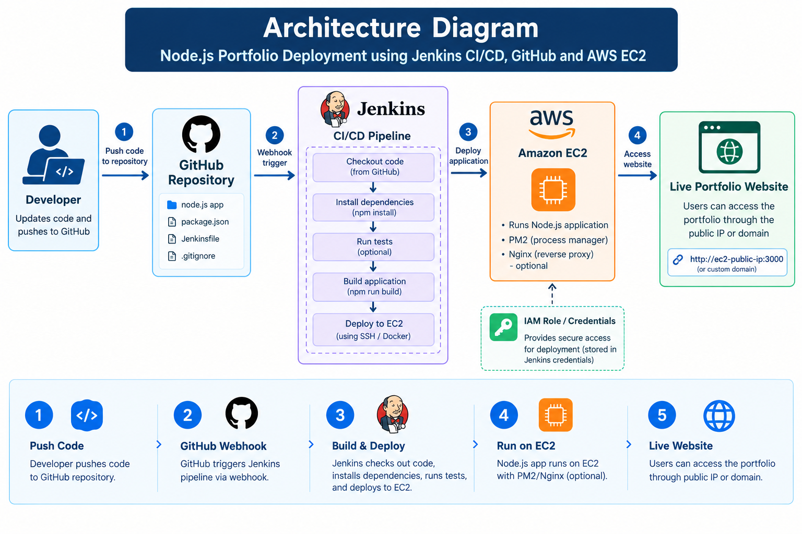
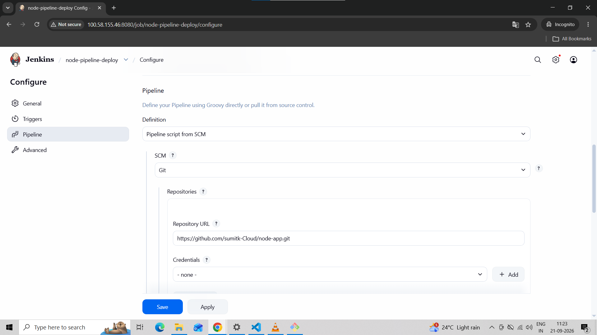
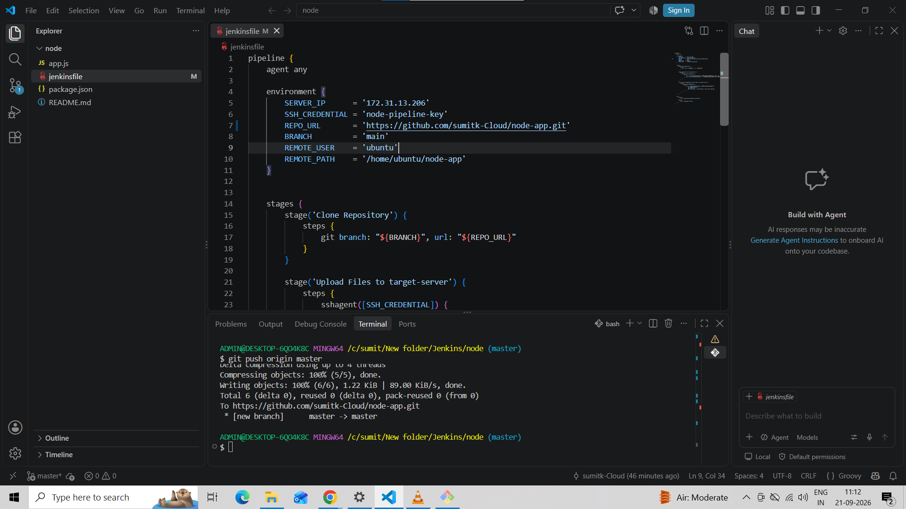
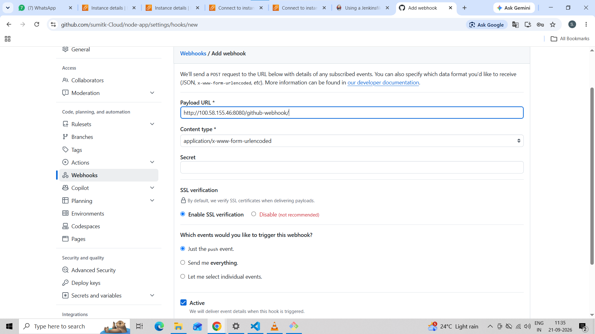
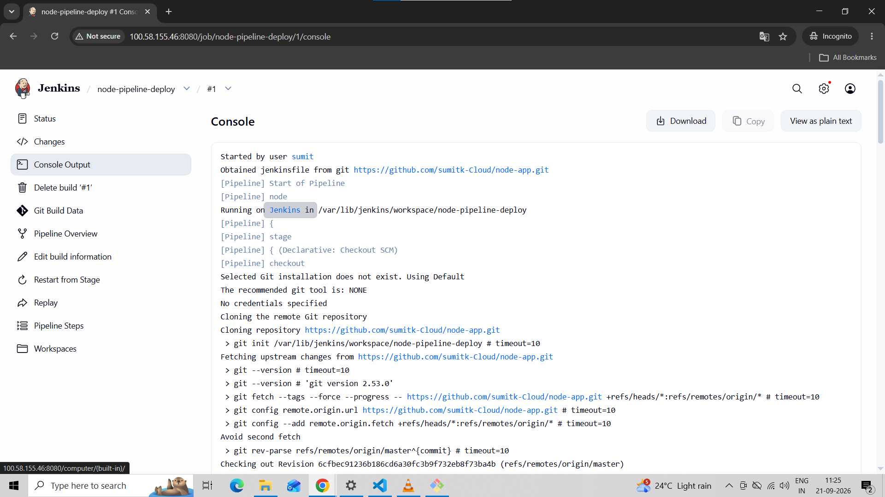

<<<<<<< HEAD
### Node.jsPortfolioDeploymentusingJenkins CI/CD, GitHub &AWS EC2
ProjectOverview
This project demonstrates the automated deployment of a Node.js portfolio application using Jenkins,GitHub, andAWSEC2. AJenkinspipelinedefined ina Jenkinsfileautomatescode checkout, dependency installation, application building, testing, and deployment to an EC2 instance.
Thegoalistosimplifyapplicationdeployment,reduce manualeffort,andimplement a continuous integration and continuous delivery (CI/CD) workflow.

### ProjectObjectives
•	AutomateNode.jsapplicationdeploymentusingJenkins.
•	IntegrateGitHubwithJenkinsusing webhooks.
•	Definepipelinestagesusinga Jenkinsfile.
•	HosttheNode.jsapplicationonAWS EC2.
•	UseGitandGitHubfor sourcecodemanagement.
•	Applysecuritybestpracticesfordeploymentcredentials.

### TechnologiesUsed

Technology	Purpose
Node.js	Applicationruntime
Git	Versioncontrol
GitHub	Sourcecoderepository
Jenkins	CI/CD automation
Jenkinsfile	Pipelinedefinition
GitHubWebhooks	TriggerJenkinsbuilds
AWS EC2	Applicationhosting
npm	Dependencymanagement
 
### ArchitectureDiagram

### ArchitectureWorkflow
1.	ThedevelopermodifiestheNode.jsportfolio application.
2.	Codeispushed tothe GitHubrepository.
3.	AGitHubwebhooktriggerstheJenkinspipeline.
4.	Jenkinschecksoutthelatestsourcecode.
5.	Jenkinsinstallsdependenciesandrunsavailabletests.
6.	Thepipelinebuildstheapplicationifabuildscriptisconfigured.
7.	JenkinsdeploystheapplicationtoAWSEC2usingSSHorDocker.
8.	UsersaccesstherunningportfoliothroughtheEC2publicIPorconfigureddomain.

### CI/CDPipeline Workflow
Stage1:SourceCodeManagement
Thedeveloperpushesupdated codeto GitHub.

Stage2:GitHubWebhookIntegration
ConfigureaGitHubwebhookto notifyJenkinswhencodeispushed. In GitHub, navigate to:
Repository→Settings→Webhooks→Add webhook

SetthepayloadURLtoyour Jenkinswebhook endpoint:
 
Stage3:BuildandTest
Jenkinschecksoutthesourcecodeand installstherequirednpm dependencies.

Stage4:DeploymenttoAWSEC2
JenkinstransferstheapplicationtotheEC2instanceusingSSHordeploysaDockerimage, depending on the selected deployment method.

Stage5:ApplicationAccess
Oncedeployment issuccessful,userscanaccesstheportfolio usingtheconfiguredpublicIP address or domain.

### AWSEC2 Configuration
1.	LaunchanEC2 instancewithasuitableLinuxoperating system.
2.	ConfigureSSHaccessfortheJenkinsdeploymentagent.
3.	ConfiguretheEC2securitygroupto allowonlytherequiredinbound traffic.
4.	Deploytheapplicationandensure it runspersistentlyusinganappropriateprocess manager, such as PM2, or a container restart policy.
5.	OptionallyconfigureNginxandadomainnamewithHTTPS.

### SecurityBestPractices
•	UseJenkinsCredentialstostoresensitivedeploymentcredentials.
•	RestrictSSHaccessto trustedsources.
•	Applyleast-privilegepermissionstoAWSIAMusersand roles.
•	Avoidcommitting.envfiles, passwords,privatekeys,orothersecretsto GitHub.
•	KeepJenkins, Node.js,dependencies,andtheoperatingsystemupdated.
•	UseHTTPSforpublic-facingapplications.
•	AvoidexposingtheJenkinsdashboarddirectlytothepublicinternet without appropriate access controls.

### 1. GitHub Repository

### 2. Jenkins Pipeline

### 3. GitHub Webhook

### 4. Successful Build

### 5. Live Portfolio Website

### KeyLearnings
•	ImplementingCI/CDwithJenkins.
•	Integrating GitHubwebhookswithJenkins.
•	ManagingNode.jsdependenciesandbuild stages.
•	Deployingapplicationsto AWS EC2.
•	Managingdeploymentcredentialssecurely.
•	Understandingautomatedapplicationdelivery.

### FutureEnhancements
•	ContainerizetheapplicationusingDocker.
•	AddDockerimagepublishingtoAmazonECR.
•	DeployusingAmazonECSorKubernetes.
•	ConfigureNginx,acustomdomain,andHTTPS.
•	Addautomatedcodequalityandsecurityscans.
•	Introducemonitoringandnotificationsforfaileddeployments.

### Author
SumitKamble
•	GitHub:sumitk-Cloud
•	LinkedIn:SumitKamble
•	Email:sumitkamble5550@gmail.com
